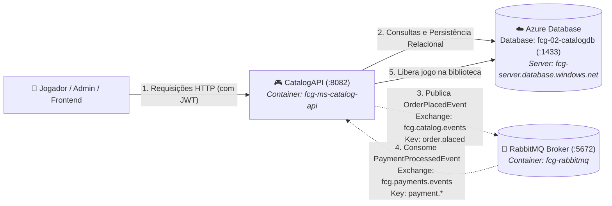

# FIAP Cloud Games - Fase 02 - Microsserviço CatalogAPI (`fcg-fase-02--catalog`)

[](https://dotnet.microsoft.com/)
[](https://azure.microsoft.com/)
[](https://www.rabbitmq.com/)
[](https://www.docker.com/)

> 🎓 **Projeto Acadêmico FIAP**  
> Este microsserviço faz parte do projeto de conclusão de curso da **"Pós-Tech: Arquitetura de Sistemas .NET"** da **FIAP**.  
> O objetivo da solução é projetar e implementar um ecossistema distribuído de nuvem voltado para uma plataforma de jogos digitais (*Cloud Gaming*), aplicando os mais modernos padrões de arquitetura corporativa em **.NET 10**.

---

> 🌐 **Documentação Principal e Orquestração do Ecossistema:**  
> A visão geral de toda a solução distribuída, a topologia de pastas, a arquitetura de redes e o guia para inicialização unificada de todos os microsserviços e bancos de dados estão centralizadas no repositório de **Orquestração**:  
> 👉 **[🚀 Acessar Ponto de Partida & Orquestração (`fcg-fase-02--orchestration`)](https://github.com/idgrego/fcg-fase-02--orchestration)**

---

## 📑 Sumário

- [1. O Microsserviço CatalogAPI](#1-o-microsserviço-catalogapi)
  - [1.1. Responsabilidades de Negócio](#11-responsabilidades-de-negócio)
  - [1.2. Papéis de Acesso e Permissões (RBAC)](#12-papéis-de-acesso-e-permissões-rbac)
  - [1.3. Diagrama de Integração](#13-diagrama-de-integração)
- [2. Tecnologias & Decisões Arquiteturais](#2-tecnologias--decisões-arquiteturais)
- [3. Como Executar a CatalogAPI](#3-como-executar-a-catalogapi)
  - [3.1. Execução Integrada via Docker Compose (Recomendado)](#31-execução-integrada-via-docker-compose-recomendado)
  - [3.2. Execução Individual (.NET CLI & Docker Local)](#32-execução-individual-net-cli--docker-local)
- [4. Endpoints HTTP & Documentação Interativa (Scalar)](#4-endpoints-http--documentação-interativa-scalar)
- [5. Mensageria Assíncrona & Eventos](#5-mensageria-assíncrona--eventos)
  - [5.1. Evento Publicado: `OrderPlacedEvent`](#51-evento-publicado-orderplacedevent)
  - [5.2. Evento Consumido: `PaymentProcessedIntegrationEvent`](#52-evento-consumido-paymentprocessedintegrationevent)
- [6. Testes Unitários](#6-testes-unitários)
- [7. Documentação Técnica Detalhada (`/docs`)](#7-documentação-técnica-detalhada-docs)

---

## 1. O Microsserviço CatalogAPI

A **CatalogAPI** é o serviço responsável pelo catálogo público de jogos digitais, controle administrativo de títulos, iniciação de pedidos de compra e gestão da biblioteca pessoal de jogos dos jogadores.

### 1.1. Responsabilidades de Negócio
- **Consulta Pública de Jogos:** Listagem com filtros por gênero/categoria (`Action`, `RPG`, `Strategy`, `Shooter`, `Sports`, etc.), paginação e detalhes de jogos disponíveis.
- **Gestão de Títulos (CRUD Administrativo):** Criação, atualização e desativação de jogos, restrito a administradores.
- **Iniciação de Compra:** Recebe solicitações de compra de jogadores autenticados, valida a existência do título e dispara o pedido assíncrono para processamento financeiro.
- **Gestão da Biblioteca do Jogador (`UserLibrary`):** Adição idempotente e segura do jogo na biblioteca do usuário assim que o pagamento é confirmado pelo broker RabbitMQ.

### 1.2. Papéis de Acesso e Permissões (RBAC)
- **Visitantes / Não autenticados (`Anonymous`):** Consulta pública ao catálogo de jogos.
- **Jogadores (`Gamer`):** Iniciação de compras (`POST /api/v1/orders`) e consulta de sua própria biblioteca (`GET /api/v1/library`).
- **Administradores (`Admin`):** Criação, edição e exclusão lógica de jogos no catálogo (`POST /api/v1/games`, `PUT /api/v1/games/{id}`, `DELETE /api/v1/games/{id}`).

### 1.3. Diagrama de Integração



---

## 2. Tecnologias & Decisões Arquiteturais

- **Runtime & Plataforma:** .NET 10 (`net10.0`), C# 14, Solution moderna `.slnx`.
- **Clean Architecture:** Desacoplamento estrito em 4 camadas (`Domain`, `Application`, `Infrastructure`, `API`).
- **Persistência Relacional com EF Core (Azure Database):** Utiliza o provedor oficial `Microsoft.EntityFrameworkCore.SqlServer` conectando ao banco dedicado `fcg-02-catalogdb` no Azure Database (`fcg-server.database.windows.net`):
  - Tabela `Games`: Catálogo de jogos digitais com índice composto `(Category, IsActive)` e serialização de tags.
  - Tabelas `UserLibraries` e `LibraryItems`: Bibliotecas individuais com mapeamento de entidade própria e índice único por `UserId` para garantir integridade e idempotência contra duplicidades.
- **Minimal APIs Modulares:** Agrupamento de rotas com `MapGroup` (`GameEndpoints`, `OrderEndpoints`, `UserLibraryEndpoints`).
- **Autenticação & Autorização JWT:** Integração com os tokens emitidos pela `UsersAPI`, validando assinatura simétrica e políticas de autorização baseadas em Roles.
- **Mensageria com RabbitMQ 7.x:** Publicação de pedidos via `RabbitMqEventPublisher` e consumo de confirmações em segundo plano via `PaymentProcessedConsumerService` (`BackgroundService`).
- **Documentação de API Moderna:** **Scalar** integrado à especificação OpenAPI nativa do .NET 10.

---

## 3. Como Executar a CatalogAPI

### 3.1. Execução Integrada via Docker Compose (Recomendado)

A forma recomendada de executar a CatalogAPI é através da orquestração unificada:

1. Navegue até a pasta de orquestração:
   ```powershell
   cd ../fcg-fase-02--orchestration
   ```

2. Inicialize todos os contêineres:
   ```powershell
   docker compose up -d --build
   ```

3. Verifique os serviços em execução:
   ```powershell
   docker compose ps
   ```

4. Inspecione os logs da CatalogAPI:
   ```powershell
   docker compose logs -f catalog-api
   ```

---

### 3.2. Execução Individual (.NET CLI & Docker Local)

Caso queira executar a **CatalogAPI** diretamente via `.NET CLI`:

1. **Subir o broker RabbitMQ (o banco é hospedado no Azure Database):**
   ```powershell
   # RabbitMQ com Management UI
   docker run -d --name rabbitmq -e RABBITMQ_DEFAULT_USER=guest -e RABBITMQ_DEFAULT_PASS=guest -p 5672:5672 -p 15672:15672 rabbitmq:3-management
   ```

2. **Aplicar as migrações no banco de dados do Azure Database:**
   Na pasta `fcg-fase-02--catalog`:
   ```powershell
   dotnet ef database update --project src/FCG02.CatalogAPI.Infrastructure --startup-project src/FCG02.CatalogAPI.API
   ```

3. **Executar a API via .NET CLI:**
   Na pasta `fcg-fase-02--catalog`:
   ```powershell
   dotnet run --project src/FCG02.CatalogAPI.API
   ```

A API estará acessível em `http://localhost:5000` (ou na porta informada no terminal).

---

## 4. Endpoints HTTP & Documentação Interativa (Scalar)

Com o serviço em execução, acesse a interface interativa do **Scalar**:

👉 **URL do Scalar:** `http://localhost:8082/scalar/v1` (no Docker) ou `http://localhost:PORTA/scalar/v1` (local).

### Principais Endpoints:

| Método | Rota | Descrição | Permissão |
|---|---|---|---|
| `GET` | `/api/v1/games` | Lista todos os jogos ativos com filtros de categoria | Pública |
| `GET` | `/api/v1/games/{id}` | Obtém os detalhes completos de um jogo | Pública |
| `POST` | `/api/v1/games` | Cadastra um novo jogo no catálogo | `Admin` |
| `PUT` | `/api/v1/games/{id}` | Atualiza dados cadastrais e preço de um jogo | `Admin` |
| `DELETE` | `/api/v1/games/{id}` | Desativa logicamente um jogo | `Admin` |
| `POST` | `/api/v1/orders` | Inicia o pedido de compra de um jogo | `Gamer` / `Admin` |
| `GET` | `/api/v1/library` | Lista a biblioteca pessoal do jogador autenticado | `Gamer` / `Admin` |
| `GET` | `/health` | Verificação de integridade do serviço | Pública |

---

## 5. Mensageria Assíncrona & Eventos

### 5.1. Evento Publicado: `OrderPlacedEvent`
Ao receber um pedido (`POST /api/v1/orders`), a API responde `202 Accepted` e publica:
- **Exchange:** `fcg.catalog.events` (Tipo: `Topic`)
- **Routing Key:** `order.placed`
- **Fila Destino:** `payments.order-placed` (consumida pela `PaymentsAPI`)

```json
{
  "eventId": "f8a7b6c5-d4e3-2a1b-0c9d-8e7f6a5b4c3d",
  "occurredOn": "2026-10-29T10:05:00Z",
  "orderId": "770e8400-e29b-41d4-a716-446655440111",
  "userId": "550e8400-e29b-41d4-a716-446655440000",
  "gameId": "67210b3a4e9b8c0012e45678",
  "price": 199.90
}
```

### 5.2. Evento Consumido: `PaymentProcessedIntegrationEvent`
O worker de segundo plano `PaymentProcessedConsumerService` escuta:
- **Exchange:** `fcg.payments.events`
- **Fila:** `catalog.payment-processed`
- **Routing Key Pattern:** `payment.*`
- **Ação:** Se `isApproved == true`, adiciona o jogo à biblioteca do usuário (`UserLibraries`) no Azure Database e emite `BasicAck`. Se falso, ignora a adição e emite `BasicAck`.

---

## 6. Testes Unitários

A **CatalogAPI** possui suíte automatizada desenvolvida com **xUnit** e **Moq**:
- **Domínio:** Validação de regras e mutações de entidades `Game` e `UserLibrary`.
- **Aplicação:** Casos de uso `GameService`, `OrderService` e `UserLibraryService` com mocks determinísticos de repositório e mensageria.

Para executar todos os testes da solução:

```powershell
dotnet test tests/FCG02.CatalogAPI.UnitTests/FCG02.CatalogAPI.UnitTests.csproj --logger "console;verbosity=detailed"
```

---

## 7. Documentação Técnica Detalhada (`/docs`)

Para um aprofundamento específico em cada camada arquitetural da CatalogAPI, consulte os documentos na pasta [`/docs`](docs/index.md):

- **[📑 Índice da Documentação Técnica da CatalogAPI](docs/index.md)**
- **[🏛️ Arquitetura e Decisões de Design](docs/architecture.md)**
- **[🧩 Camada de Domínio & DDD](docs/domain.md)**
- **[⚙️ Camada de Aplicação, DTOs e Casos de Uso](docs/application.md)**
- **[☁️ Camada de Infraestrutura, EF Core e RabbitMQ](docs/infrastructure.md)**
- **[🚀 Camada de Apresentação, Minimal APIs e JWT](docs/api.md)**
- **[🧪 Suíte de Testes Unitários](docs/tests.md)**
- **[🐳 Containerização e Docker Multi-stage](docs/docker.md)**
- **[☸️ Orquestração com Kubernetes](docs/k8s.md)**
