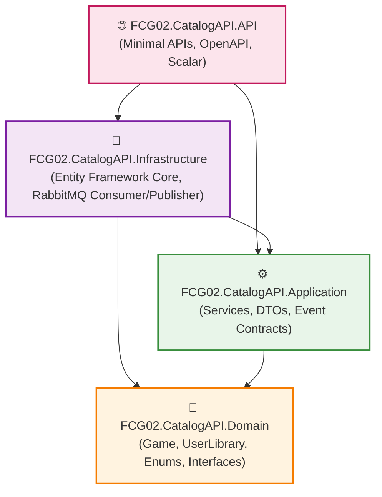
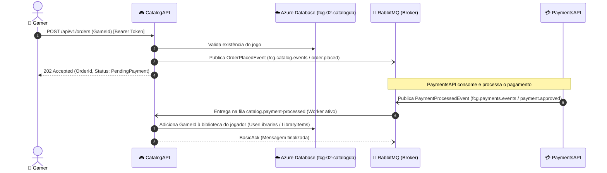

# CatalogAPI - Arquitetura e Decisões de Design

Este documento apresenta a arquitetura interna do microsserviço **CatalogAPI** (`fcg-fase-02--catalog`), detalhando as decisões técnicas, a segregação de responsabilidades via **Clean Architecture**, a escolha do **Azure Database** e o desacoplamento orientado a eventos via **RabbitMQ**.

---

## 📑 Sumário

- [1. Visão Geral da Clean Architecture](#1-visão-geral-da-clean-architecture)
- [2. Estrutura de Camadas e Dependências](#2-estrutura-de-camadas-e-dependências)
- [3. O Banco de Dados Relacional: Azure Database](#3-o-banco-de-dados-relacional-azure-database)
- [4. Autenticação Stateless e Validação de Tokens JWT](#4-autenticação-stateless-e-validação-de-tokens-jwt)
- [5. Fluxo Orientado a Eventos (EDA)](#5-fluxo-orientado-a-eventos-eda)
- [6. Navegação](#6-navegação)

---

## 1. Visão Geral da Clean Architecture

A **CatalogAPI** adota os princípios da Clean Architecture de Robert C. Martin (Uncle Bob), garantindo que as regras de negócio sejam o elemento central e mais protegido da aplicação, completamente isoladas de preocupações de infraestrutura, bancos de dados e protocolos de rede.

---

## 2. Estrutura de Camadas e Dependências

1. **`Domain` (Núcleo Puro):**
   - Não possui referências externas a nenhum framework, ORM ou biblioteca de mensageria.
   - Contém as entidades de negócio (`Game`, `UserLibrary`), enums (`GameCategory`) e interfaces de abstração (`IGameRepository`, `IUserLibraryRepository`).
2. **`Application` (Casos de Uso):**
   - Conhece apenas a camada de `Domain`.
   - Contém DTOs imutáveis, orquestração de regras de negócio (`GameService`, `OrderService`, `UserLibraryService`) e contratos de eventos (`OrderPlacedEvent`).
3. **`Infrastructure` (Detalhes Técnicos):**
   - Implementa os contratos de repositório utilizando `Entity Framework Core` e o publicador/consumidor assíncrono com `RabbitMQ.Client`.
   - Mantém as dependências tecnológicas restritas a esta camada.
4. **`API` (Ponto de Entrada):**
   - Configura o container de Injeção de Dependências, os middlewares HTTP, a autenticação JWT Bearer e mapeia os grupos de Minimal APIs modulares.

---

## 3. O Banco de Dados Relacional: Azure Database

O microsserviço de catálogo e biblioteca adota o padrão **Database-per-Service** utilizando o **Azure Database** (servidor `fcg-server.database.windows.net`, banco dedicado `fcg-02-catalogdb`):

- **Consistência Relacional:** Catálogos de jogos e bibliotecas de usuários se beneficiam de restrições relacionais (constraints) e transações ACID fortes, garantindo a integridade financeira e de posse de itens.
- **Consultas Estruturadas & Índices:** Consultas por categoria ou títulos populares são resolvidas com índices compostos de alta performance `(Category, IsActive)` no SQL Server, com serialização JSON otimizada para o armazenamento das tags dos jogos.
- **Idempotência de Biblioteca:** A entidade `UserLibrary` utiliza relacionamentos de posse (owned entities no EF Core com a tabela `LibraryItems`) para gerenciar os itens da biblioteca de cada jogador, garantindo unicidade através de índice exclusivo por `UserId`, eliminando o risco de duplicidade na posse de jogos.

---

## 4. Autenticação Stateless e Validação de Tokens JWT

Para evitar acoplamento síncrono e gargalos de rede:
- A `CatalogAPI` **NÃO** faz chamadas HTTP para a `UsersAPI` a cada requisição para saber se o jogador existe.
- A validação é puramente criptográfica e **stateless**: a `CatalogAPI` valida a assinatura do token JWT Bearer utilizando a chave simétrica compartilhada (`Jwt:SecretKey`).
- As claims `NameIdentifier` (UserId) e `Role` são extraídas localmente em memória pelo middleware do ASP.NET Core, garantindo altíssima performance.

---

## 5. Fluxo Orientado a Eventos (EDA)

A CatalogAPI atua simultaneamente como **Produtora** e **Consumidora** de eventos no broker RabbitMQ:

---

## 6. Navegação

- ⬅️ **[Voltar para o Índice da Documentação](index.md)**
- ➡️ **[Avançar para a Camada de Domínio (`domain.md`)](domain.md)**
