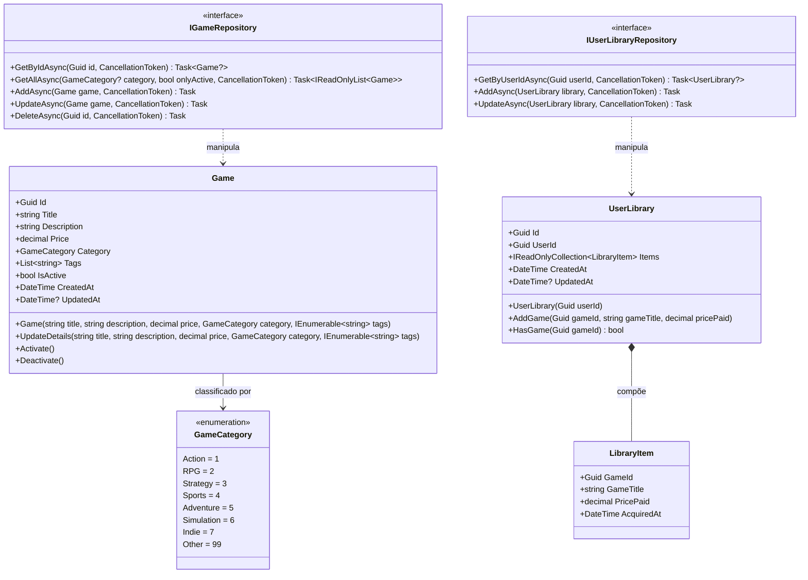

# CatalogAPI - Documentação Técnica: Camada de Domínio

A camada **`FCG02.CatalogAPI.Domain`** encapsula as regras de negócio essenciais relacionadas a jogos digitais e bibliotecas pessoais de jogadores. Ela é pura e independente de frameworks, ORMs ou bibliotecas externas.

---

## 📑 Sumário

- [1. Visão Geral e Diagrama de Classes](#1-visão-geral-e-diagrama-de-classes)
- [2. Entidade Rica: `Game`](#2-entidade-rica-game)
  - [2.1. Princípios de Encapsulamento e Invariantes](#21-princípios-de-encapsulamento-e-invariantes)
  - [2.2. O Uso de UUIDv7 Sequencial (`Guid.CreateVersion7`)](#22-o-uso-de-uuidv7-sequencial-guidcreateversion7)
- [3. Agregado de Biblioteca: `UserLibrary` e `LibraryItem`](#3-agregado-de-biblioteca-userlibrary-e-libraryitem)
  - [3.1. Garantia de Idempotência e Unicidade](#31-garantia-de-idempotência-e-unicidade)
  - [3.2. Explicação do Código de Adição de Jogo](#32-explicação-do-código-de-adição-de-jogo)
- [4. Enumeração: `GameCategory`](#4-enumeração-gamecategory)
- [5. Interfaces de Repositório (Inversão de Dependência)](#5-interfaces-de-repositório-inversão-de-dependência)
- [6. Navegação](#6-navegação)

---

## 1. Visão Geral e Diagrama de Classes



---

## 2. Entidade Rica: `Game`

Localização: `src/FCG02.CatalogAPI.Domain/Entities/Game.cs`

### 2.1. Princípios de Encapsulamento e Invariantes
A entidade `Game` protege seu próprio estado contra modificações arbitrárias externas através de `private set` e métodos com validações incorporadas:
- O título não pode ser nulo ou vazio e possui tamanho máximo de 150 caracteres.
- A descrição é limitada a 2000 caracteres.
- O preço nunca pode ser negativo (`price >= 0`) e é automaticamente arredondado para duas casas decimais (`decimal.Round(price, 2)`).
- As tags são sanitizadas (letras minúsculas e sem duplicidade).
- O controle de disponibilidade é operado via métodos semânticos `Activate()` e `Deactivate()`.

### 2.2. O Uso de UUIDv7 Sequencial (`Guid.CreateVersion7`)
Diferente dos identificadores tradicionais UUIDv4 (aleatórios), o .NET 10 permite a geração nativa de **UUIDv7**:
- O `Guid.CreateVersion7()` embute um timestamp de milissegundos nos primeiros bits do identificador.
- **Vantagem no Azure Database (SQL Server):** Otimiza a inserção sequencial em índices B-Tree, reduzindo drasticamente a fragmentação de páginas de dados e melhorando o desempenho de buscas e inserções sem sobrecarga adicional.

---

## 3. Agregado de Biblioteca: `UserLibrary` e `LibraryItem`

Localização: `src/FCG02.CatalogAPI.Domain/Entities/UserLibrary.cs`

### 3.1. Garantia de Idempotência e Unicidade
A entidade `UserLibrary` atua como a raiz do agregado da biblioteca de um jogador:
- A lista interna de jogos `_items` é privada e só é exposta publicamente como `IReadOnlyCollection<LibraryItem>`.
- O método `HasGame(Guid gameId)` checa se o jogador já adquiriu o título.
- Se o método `AddGame` for chamado para um jogo já existente, ele rejeita com `InvalidOperationException`, protegendo a consistência do domínio caso uma mensagem duplicada seja entregue pelo RabbitMQ.

```csharp
public void AddGame(Guid gameId, string gameTitle, decimal pricePaid)
{
    if (gameId == Guid.Empty)
        throw new ArgumentException("GameId cannot be empty", nameof(gameId));
    if (string.IsNullOrWhiteSpace(gameTitle))
        throw new ArgumentException("Game title cannot be empty", nameof(gameTitle));
    if (pricePaid < 0)
        throw new ArgumentException("Price paid cannot be negative", nameof(pricePaid));
    if (HasGame(gameId))
        throw new InvalidOperationException($"Game '{gameTitle}' is already in user library");

    var item = new LibraryItem(
        GameId: gameId,
        GameTitle: gameTitle.Trim(),
        PricePaid: decimal.Round(pricePaid, 2),
        AcquiredAt: DateTime.UtcNow
    );
    _items.Add(item);
    UpdatedAt = DateTime.UtcNow;
}
```

---

## 4. Enumeração: `GameCategory`

Localização: `src/FCG02.CatalogAPI.Domain/Enums/GameCategory.cs`

Permite a indexação e filtro de títulos no catálogo:
- `Action = 1`, `RPG = 2`, `Strategy = 3`, `Sports = 4`, `Adventure = 5`, `Simulation = 6`, `Indie = 7`, `Other = 99`.

---

## 5. Interfaces de Repositório (Inversão de Dependência)

Em conformidade com o **D do SOLID**, os repositórios são declarados como contratos puros no domínio:
- **`IGameRepository`:** Métodos assíncronos para CRUD e consultas por categoria com suporte a cancelamento cooperativo (`CancellationToken`).
- **`IUserLibraryRepository`:** Busca e persistência da biblioteca de um usuário específico por `UserId`.

---

## 6. Navegação

- ⬅️ **[Voltar para a Arquitetura (`architecture.md`)](architecture.md)**
- ➡️ **[Avançar para a Camada de Aplicação (`application.md`)](application.md)**
