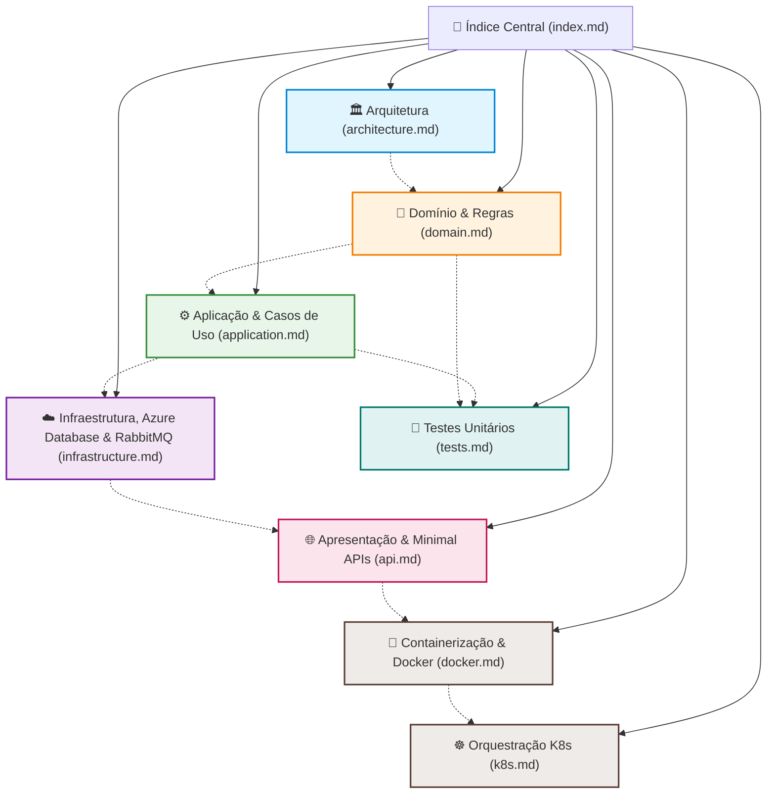

# CatalogAPI - Índice da Documentação Técnica

Bem-vindo à documentação técnica oficial da **CatalogAPI** (`fcg-fase-02--catalog`), microsserviço responsável pela gestão do catálogo de jogos digitais, biblioteca pessoal do jogador, iniciação de pedidos e consumo de confirmações financeiras na plataforma **FIAP Cloud Games**.

---

## 🗺️ Mapa de Navegação da Documentação

---

## 📚 Módulos de Documentação

### 1. [🏛️ Arquitetura da Solução (`architecture.md`)](architecture.md)
Visão geral da Clean Architecture aplicada a microsserviços, diagrama de dependência entre camadas, segregação de banco de dados (*Database-per-Service*) com Azure Database e fluxo orientado a eventos com RabbitMQ.

### 2. [🧩 Camada de Domínio (`domain.md`)](domain.md)
Detalhamento das regras e entidades do domínio:
- Entidade `Game` (identificador Guid/UUID, categoria, preço, tags serializadas e controle de ativação).
- Entidade `UserLibrary` e itens da biblioteca (`LibraryItem`) com garantia de idempotência.
- Enum `GameCategory` e interfaces de repositório (`IGameRepository`, `IUserLibraryRepository`).

### 3. [⚙️ Camada de Aplicação (`application.md`)](application.md)
Detalhamento da lógica de negócio e orquestração:
- DTOs imutáveis (`GameDto`, `CreateGameDto`, `UpdateGameDto`, `CreateOrderDto`, `UserLibraryDto`).
- Contratos de eventos: `OrderPlacedEvent` e `PaymentProcessedIntegrationEvent`.
- Casos de uso implementados em `GameService`, `OrderService` e `UserLibraryService`.

### 4. [☁️ Camada de Infraestrutura (`infrastructure.md`)](infrastructure.md)
Detalhamento técnico da persistência e mensageria:
- Configuração do Azure Database (`CatalogDbContext`, provedor `Microsoft.EntityFrameworkCore.SqlServer`, mapeamento via Fluent API, criação de índices).
- Implementação dos repositórios com `Entity Framework Core`.
- Publicação de pedidos com `RabbitMqEventPublisher`.
- Consumo assíncrono de pagamentos em segundo plano com `PaymentProcessedConsumerService` (`BackgroundService`).

### 5. [🚀 Camada de Apresentação (`api.md`)](api.md)
Endpoints HTTP, autenticação e documentação:
- Minimal APIs agrupadas via `MapGroup` em `GameEndpoints`, `OrderEndpoints` e `UserLibraryEndpoints`.
- Autenticação e Autorização baseada em Claims e Roles JWT (`Gamer`, `Admin`).
- Documentação interativa moderna com **Scalar** (`/scalar/v1`).
- Configuração do pipeline no `Program.cs`.

### 6. [🧪 Suíte de Testes Unitários (`tests.md`)](tests.md)
Testes automatizados com xUnit e Moq:
- Testes de domínio para invariantes de entidades e validação de regras de preço.
- Testes de serviços de aplicação com simulação isolada de repositórios e eventos.
- Guia de execução CLI.

### 7. [🐳 Containerização com Docker (`docker.md`)](docker.md)
Empacotamento para ambientes de contêineres:
- `Dockerfile` multi-stage otimizado para .NET 10.
- Execução não-root segura com `USER app`.
- Integração ao Docker Compose com healthchecks e dependências.

### 8. [☸️ Orquestração com Kubernetes (`k8s.md`)](k8s.md)
Arquitetura de implantação em clusters Kubernetes:
- Manifestos na pasta `/k8s` (`ConfigMap`, `Secret` em Base64, `Deployment`, `Service` ClusterIP).
- Réplicas de Pods (2) com consumidor de mensageria ativo em alta disponibilidade.
- Sondas de integridade (`readinessProbe` e `livenessProbe`) integradas ao `/health`.
- Limites e requisições de recursos computacionais (`resources: requests/limits`).
